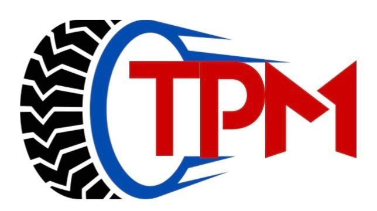

# PT Triputra Permata Makmur — Company Website

**Static, bilingual (EN / ID) company website for PT Triputra Permata Makmur, an importer and distributor of truck and bus tires.**

The site shows the company profile, the RAPID and DEROCK heavy-duty radial tire brands, a product catalog with spec sheets, and the distribution network. It's plain HTML/CSS/JS with no build step and is hosted on GitHub Pages.

**Live:** https://melvernmogens.github.io/tpm/



## Pages

| File | Content |
|---|---|
| `index.html` | Hero, "Official Distributor For" brand showcase, footer / contact |
| `services.html` | Company values & services |
| `products.html` | Product catalog cards |
| `product-detail.html` | Single product page, picked via `?id=<product>` (e.g. `product-detail.html?id=rd52`) |
| `about.html` | Company profile |
| `distribution.html` | Distribution channel |

## Features

- **EN / ID language switcher.** Text is tagged with `data-i18n` keys, translations live in `script.js`, and the choice is saved in `localStorage` (`site-lang`).
- **Product database in JS.** The `productDatabase` object in `script.js` drives the detail page: title, category, image, bullets per language, and a technical spec table. Models currently listed: RD52, RS10HD, RD51, RA20, RD31HD, RD50HD, RA21HD.
- Responsive navbar with a hamburger menu, plus scroll-reveal animations.
- Fonts: Montserrat (Google Fonts). Icons: Font Awesome 6 (CDN).

## Run locally

```bash
git clone https://github.com/MelvernMogens/tpm.git
cd tpm
python3 -m http.server 8000   # then open http://localhost:8000
```

Opening `index.html` directly works too.

## Editing

- **New product:** add an image to `assets/`, add an entry to `productDatabase` in `script.js`, then add a card in `products.html` that links to `product-detail.html?id=<key>`.
- **New text:** add the same key under both `en` and `id` in `translations` in `script.js`, then put `data-i18n="<key>"` on the element.

## Project structure

```
tpm/
├── *.html        # six pages
├── style.css     # all styles
├── script.js     # i18n, product database, nav, animations
└── assets/       # logo, brand banners, tire photos
```

---

All rights reserved. Product names and brand images belong to their respective owners.

Built by [Melvern Mogens](https://github.com/MelvernMogens).
